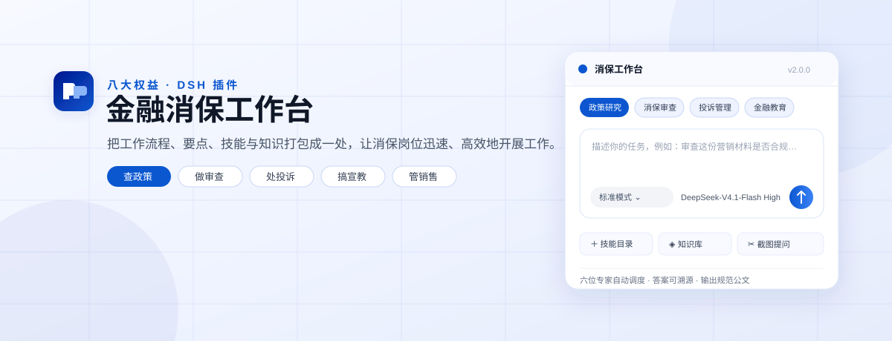

# dsh-fcp · 金融消保工作台



> **把金融消费者权益保护岗位的工作流程、要点、技能与知识，打包成一个工作台。** 消保从业人员打开即用，迅速、高效地开展日常工作。

[](https://github.com/openfcp/dsh-fcp/releases)
[](LICENSE)
[](https://github.com/openfcp/dsh-fcp)

---

## 为什么需要它？

消保工作横跨政策、审查、投诉、宣教、销售、综合管理六条线，流程长、口径严、材料多。传统方式是「翻文件 + 找模板 + 拼材料」，费时且容易漏项。

**dsh-fcp 把这些沉淀成一个工作台**：你只需用一句话描述任务，系统自动匹配专家、带出技能、检索知识库，并输出对齐监管口径的规范成果。新手也能按标准流程开展，熟手可以把效率再提一截。

- ✅ 六位消保专家自动调度，也可手动点选
- ✅ 金融技能目录即装即用，与其他插件双向同步
- ✅ IMA / Obsidian / 本地知识优先检索，答案可溯源
- ✅ 思维方法卡片、模型设置、截图提问一应俱全
- ✅ macOS 与 Windows 全界面适配

---

## 它能做什么？

| 工作场景 | 一句话说出需求，工作台帮你完成 |
| --- | --- |
| **查政策** | 监管新规精读、效力辨识、影响面分析、制度修订清单 |
| **做审查** | 产品/营销材料/协议条款的六维合规审查，输出《消保审查意见书》 |
| **处投诉** | 投诉分类打标、答复口径、溯源分析、整改台账，含 15/30/60 日时限提示 |
| **搞宣教** | 宣教活动策划、文案与物料、培训课件与考题、效果评估 |
| **管销售** | 营销八不得检查、适当性匹配、双录与可回溯检查 |
| **写公文** | 综合管理、消保评价自评、迎检材料与规范公文输出 |

**适用人群**：银行、保险、证券、支付等机构的消保条线从业人员，以及合规、客服、内控、审计中承担消保职责的岗位。

---

## 核心功能

### 🧭 首页：一句话开始工作

- 六个专家胶囊（政策研究 / 消保审查 / 投诉管理 / 金融教育 / 综合管理 / 销售管理），可不选，系统按内容自动调度
- 输入框工具行：`＋` 添加文件/技能 · `剪刀` 截图 · `工作模式` 标准/PTC/极简/创造 · `模型全名` 切换 · `话筒` · `发送`
- 点发送或按 Enter **直接进入对话流程并开始执行**，无需二次点击
- 右上角 IMA / Obsidian / 设置三个按钮，macOS 与 Windows 均可点击

### 🧩 技能：即装即用的能力市场

- 界面与「金融技能」插件一致：banner、数据源/更新、唯一刷新按钮、搜索、全部/已安装、分类胶囊、长条卡片
- 点「安装」会把技能真正下载到共享技能目录，**立即生效、无需重启**，与其他插件互相可见、双向同步
- 安装后在输入框 `＋ → 选择技能` 中即可勾选

### 📚 知识：让每条结论有据可依

内置一个**模型可调用的知识检索工具**，回答法规、条款、审查口径等问题前自动查证，检索顺序固定为 **IMA 知识库 → Obsidian → 上传知识库**：

- **IMA**（远程 API，跨机器可用）：上下两部分配置——上半填 API Key / Client ID 保存凭证，下半表格勾选知识库（国家法律知识库、八大权益消保知识库为固定阅读）
- **Obsidian**：绑定 Vault，作为只读知识源，按关键词检索笔记
- **上传知识库**：支持 `.md` / `.zip` 知识包，上传即在本机建立索引，可逐条删除。适合把 rag-kb 这类离线资料自行打包带到任意电脑，不内置安装
- 三处都未命中时如实说明「未检索到权威依据」，**不编造**条号、文件名或引用来源
- 全部为本插件自有能力，不依赖任何本机预装的 MCP 知识库；换一台电脑只需重新填凭证、绑定目录或重传知识包

### 🧠 思维与模型

- 内置 SWOT、5W2H、金字塔原理、六顶思考帽、鱼骨图/5Why、优先级矩阵、PDCA 等思维卡片，可按任务自动调配
- 模型卡片化管理，云端模型带云朵标识；支持从 DeepSeek、通义千问、豆包、智谱、Kimi、MiniMax、混元等主流模型预设一键添加

---

## 安装

1. 从 [Releases](https://github.com/openfcp/dsh-fcp/releases) 下载 `dsh-fcp-2.1.0.zip` 并解压；或直接克隆本仓库：

   ```sh
   git clone https://github.com/openfcp/dsh-fcp.git
   ```

2. 用 DSH 命令行安装本地目录（macOS 示例）：

   ```sh
   DSH="/Applications/DeepSeek Harness.app/Contents/Resources/runtime/cli/bin/dsh"
   "$DSH" plugin --profile desktop add "file:/path/to/dsh-fcp"
   ```

   Windows 下请使用对应的 `dsh` 命令路径。

3. **完全退出 DSH 再重新打开**（仅改客户端时可在页面刷新）。

安装或更新 Host 后如提示「接口未就绪」，退出重开即可。

---

## 隐私与安全

- 配置（IMA Key、Obsidian 路径、模型、技能选择）保存在浏览器 `localStorage`；技能安装状态保存在共享技能目录 `~/.dsh/skills`
- 知识检索配置会同步一份到本机 `~/.dsh/storages/fcp/kb-config.json`（权限 600）供检索工具读取；上传的知识库索引在 `~/.dsh/storages/fcp/kb-index.json`。全部只在本机，不上传第三方
- IMA API Key 等凭证仅在本机与 IMA 官方接口之间传递，不上传第三方
- 所有 `/api/fcp/*` 路由只监听本机回环，校验 `Host` 白名单；写操作要求同源自定义头与 JSON 请求体，抵御 DNS rebinding 与跨站请求
- 目录选择限定在用户主目录内，技能 id 有白名单与长度限制
- 插件不包含任何账号凭据或个人身份信息

---

## 开发与自检

```sh
npm test                      # node:test 测试套件
node --check lib/index.js
node --check lib/client.js
node --check lib/skills.js
node --check lib/experts.js
```

目录结构：

```
dsh-fcp/
├── assets/hero.svg         头图
├── lib/
│   ├── index.js            Host：路由守卫、会话绑定、专家注入、技能路由
│   ├── skills.js           共享技能安装层（真安装 / 扫描 / 即时生效）
│   ├── experts.js          六位专家与关键词路由
│   ├── client.js           浏览器半：首页、设置、技能、知识、截图
│   └── logo.png
├── test/                   本地测试
└── .github/workflows/       CI：语法检查与测试
```

---

## 版本历史

- **2.1.0**：新增模型可调用的知识检索工具 `fcp_search_knowledge`，按 IMA → Obsidian → 上传知识库 三档顺序查证，未命中如实说明、不编造引用；设置新增「上传知识库」，支持 Markdown / zip 知识包本地上传与即时索引；提示词去除对具体 MCP 工具名的硬编码，换电脑只需重配凭证或重传知识包即可用。
- **2.0.0**：输入框与工作模式改造、一键进入流程、技能页对齐金融技能插件、技能真安装与跨插件即时同步、IMA 上下分区、模型卡片与预设、全平台适配、帮助页与头图、性能优化；许可证改为个人非商业协议。
- **1.0.1**：安全加固、截图修复、补测试与 CI。
- **1.0.0**：首个公开发布版本。

---

## 许可证与联系

本插件采用**个人非商业使用许可协议（APEC）**，仅供个人下载、学习与研究使用，**禁止商用**。详见 [LICENSE](LICENSE)。

问题、建议与合作：**support@openfcp.com**

作者：**八大权益**
